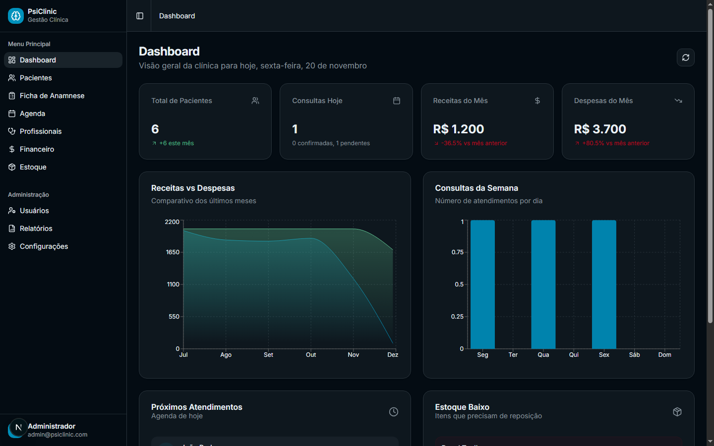
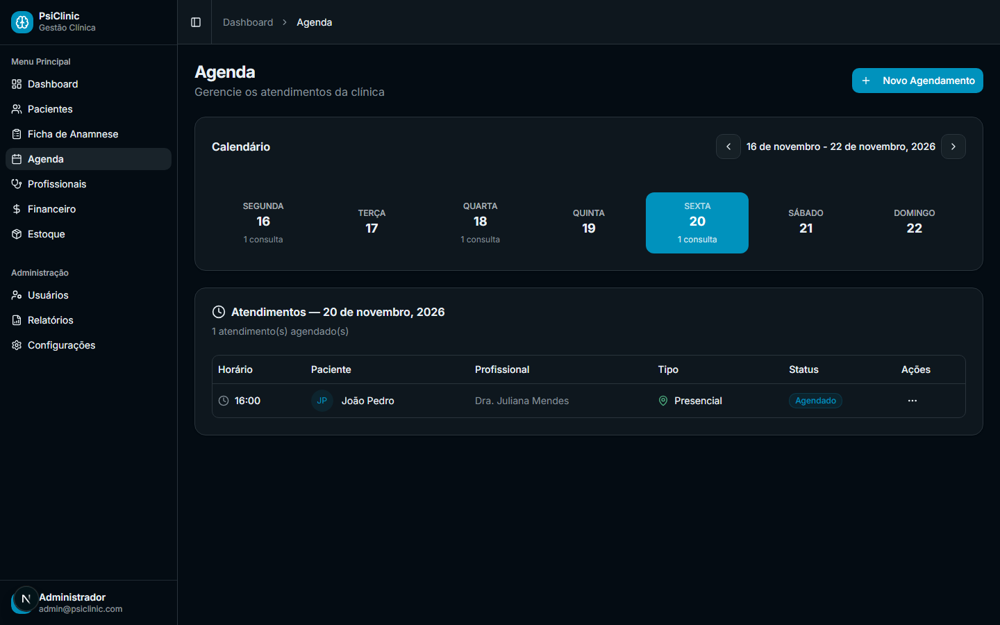
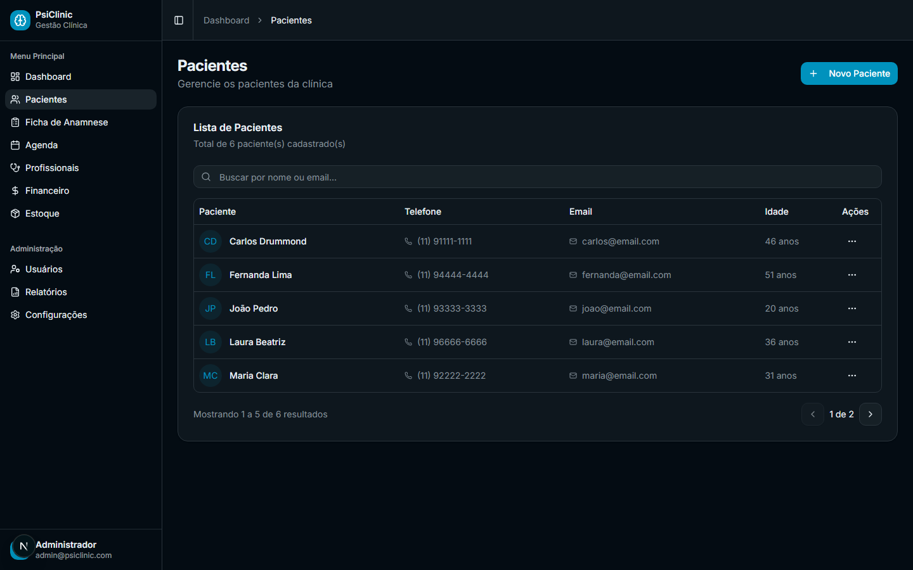
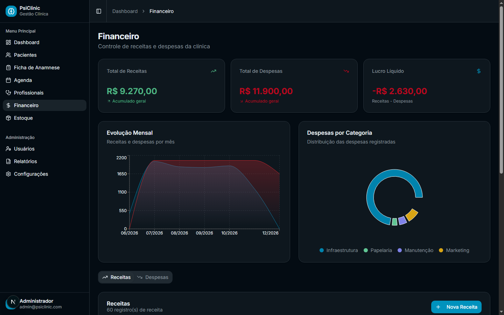
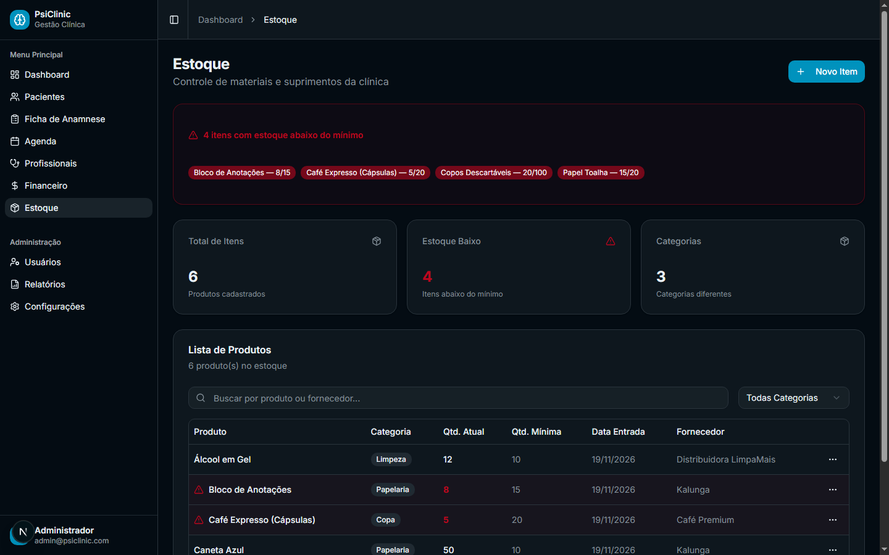
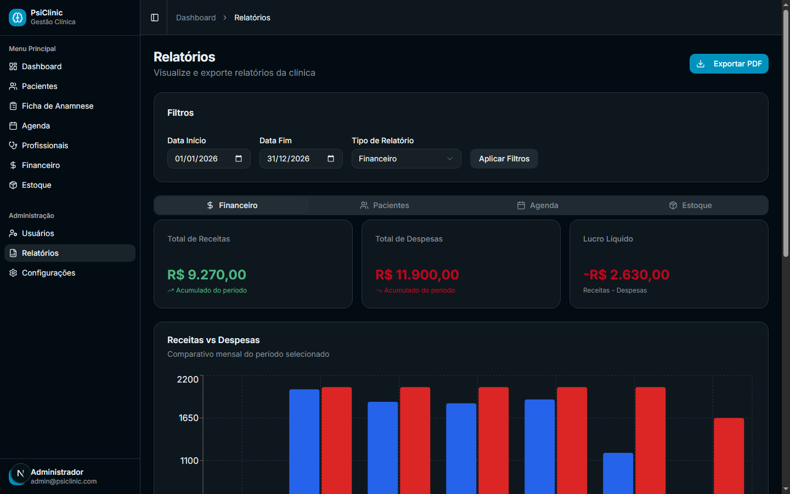
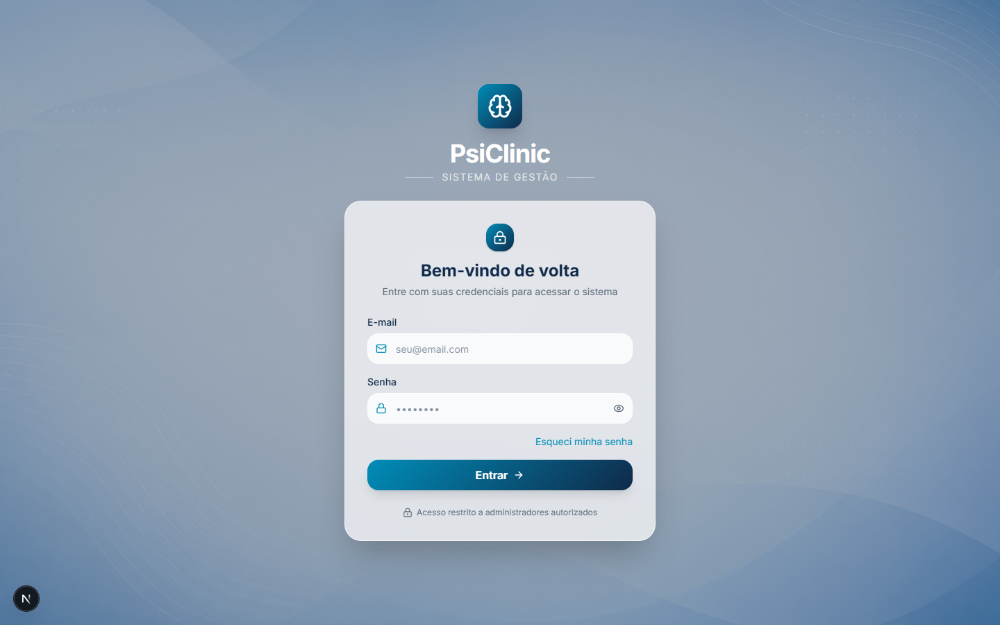

# PsiClinic — Sistema de Gestão para Clínica de Psicologia

Sistema web de gestão clínica desenvolvido como projeto final da disciplina **Programação e Otimização de Banco de Dados (POBD)** na UNIBRA, sob orientação do professor André Ribeiro.

**Stack:** Next.js 16.2.6 · TypeScript · Tailwind CSS · PostgreSQL (Supabase) · Radix UI · Recharts

---

## Módulos do Sistema

| Módulo | Descrição | Status |
|---|---|---|
| Pacientes e Anamnese | Cadastro, ficha clínica, contato de emergência | Concluído |
| Agenda de Atendimentos | Calendário, status, validação de conflito | Concluído |
| Controle Financeiro | Receitas, despesas, resumo mensal, lucro | Concluído |
| Controle de Estoque | Itens, movimentações, alertas críticos | Concluído |
| Relatórios e Dashboards | Gráficos integrados com views do banco | Concluído |
| Profissionais | Cadastro, especialidade, registro de classe (CRP) | Concluído |
| Usuários Administrativos | Listagem, cadastro e edição de usuários do sistema | Concluído |
| Autenticação JWT | Login, logout, proteção de rotas, cookie httpOnly | Concluído |

---

## 📸 Telas do Sistema

### 📊 Dashboard Principal
Visão consolidada com indicadores-chave em tempo real (pacientes ativos, atendimentos diários, saldo mensal e alertas operacionais), alimentados diretamente por views e functions do PostgreSQL.



### 📅 Agenda de Atendimentos
Controle de agendamentos de consultas (presencial e online) com prevenção automática de conflitos de horários via trigger no banco de dados.



### 👤 Gestão de Pacientes e Anamnese
Cadastro operacional com cálculo de idade em tempo real (`fn_calcular_idade`), dados de contato de emergência e histórico clínico.



### 💰 Controle Financeiro
Fluxo de caixa completo com receitas vinculadas a pacientes, despesas operacionais e cálculo automático de lucratividade líquida via stored procedures.



### 📦 Controle de Estoque
Monitoramento de materiais e insumos da clínica com destaque visual automático para itens abaixo da quantidade mínima (`vw_lista_estoque_critico`).



### 📈 Relatórios e Gráficos
Módulo de inteligência analítica com gráficos comparativos e consolidação de produtividade, finanças e estoque.



### 🔐 Autenticação e Acesso
Interface de login segura protegida por JWT (cookies `httpOnly`), com senhas criptografadas em Bcrypt (cost 12) e controle de bloqueio.



---

## Como Rodar Localmente

### 1. Clone o repositório

```bash
git clone git@github.com:lucasferreirafs/PsiClinic.git
cd PsiClinic
```

### 2. Instale as dependências

```bash
npm install
```

### 3. Configure as variáveis de ambiente

Crie o arquivo `.env.local` na raiz do projeto (veja `.env.example`):

```bash
DATABASE_URL=postgresql://[usuario]:[senha]@[host]:5432/[banco]?sslmode=require
JWT_SECRET=gere_um_segredo_longo_e_aleatorio
```

> O arquivo `.env.local` está no `.gitignore` e **nunca deve ser commitado**.

### 4. Rode o servidor de desenvolvimento

```bash
npm run dev
```

Acesse: `http://localhost:3000`

### 5. Valide a conexão com o banco

```
http://localhost:3000/api/test-db
```

Resposta esperada: `{ "success": true, "now": "...", "database": "postgres" }`

---

## Banco de Dados

O banco PostgreSQL está hospedado no **Supabase**. O schema completo está em `database_schema.sql`.

| Recurso | Quantidade |
|---|---|
| Tabelas | 11 (+ `usuarios` via patch) |
| Stored Procedures | 14 (+ 2 novas via patches) |
| Functions | 6 |
| Triggers | 17+ |
| Views | 4 |

Para aplicar o schema em um banco novo:
```bash
# Abra o SQL Editor no Supabase Dashboard e cole o conteúdo de database_schema.sql
```

Para aplicar os patches adicionais (após o schema base):
```bash
# Execute em ordem no Supabase SQL Editor:
# 1. docs/sql/patch_sp_atualizar_anamnese_completa.sql
# 2. docs/sql/patch_sp_atualizar_paciente_completo.sql
# 3. docs/sql/patch_usuarios.sql
# 4. docs/sql/patch_auth_usuarios.sql
```

---

## Estrutura de Pastas

```
PsiClinic/
├── docs/                        # Documentação técnica completa
│   ├── screenshots/             # Capturas de tela dos módulos do sistema
│   ├── 01-visao-geral.md
│   ├── 02-modelagem-banco.md
│   ├── 03-stored-procedures.md
│   ├── 04-functions.md
│   ├── 05-triggers.md
│   ├── 06-views.md
│   ├── 07-integracao-api.md
│   ├── 08-deploy-e-ambiente.md
│   ├── 09-checklist-entrega.md
│   ├── 10-der-plantuml.md
│   └── DOCUMENTACAO_FINAL.md    # Documento consolidado para PDF
├── src/
│   ├── app/
│   │   ├── api/                 # Route Handlers (server-side)
│   │   │   ├── agenda/
│   │   │   ├── estoque/
│   │   │   ├── financeiro/
│   │   │   ├── pacientes/
│   │   │   ├── profissionais/
│   │   │   ├── relatorios/
│   │   │   ├── auth/            # login, logout, me
│   │   │   ├── usuarios/
│   │   │   └── test-db/
│   │   └── dashboard/           # Páginas do sistema
│   ├── components/              # Componentes reutilizáveis
│   └── lib/
│       ├── db.ts                # Conexão com o banco (pool)
│       └── auth.ts              # Utilitários JWT e bcrypt
├── middleware.ts                # Proteção de rotas /dashboard/*
├── scripts/
│   └── create-admin-user.js     # Seed do usuário administrador
├── database_schema.sql          # Schema completo do PostgreSQL
├── .env.local                   # Variáveis de ambiente (não commitado)
├── .env.example                 # Modelo de variáveis de ambiente
└── package.json
```

---

## Rotas Principais da API

| Rota | Descrição |
|---|---|
| `GET /api/test-db` | Valida conexão com o banco |
| `GET /api/pacientes` | Lista pacientes ativos |
| `POST /api/pacientes` | Cadastra novo paciente |
| `GET /api/agenda` | Lista agendamentos |
| `POST /api/agenda` | Cria agendamento |
| `PATCH /api/agenda/status` | Atualiza status do atendimento |
| `GET /api/financeiro/resumo` | Resumo financeiro mensal |
| `GET /api/estoque` | Lista itens de estoque |
| `POST /api/estoque/movimentar` | Movimentação de estoque |
| `GET /api/relatorios/resumo` | Cards do dashboard |
| `GET /api/usuarios` | Lista usuários administrativos |
| `POST /api/usuarios` | Cadastra novo usuário (com senha hasheada) |
| `POST /api/auth/login` | Autenticação — seta cookie JWT httpOnly |
| `POST /api/auth/logout` | Encerra sessão — remove cookie |
| `GET /api/auth/me` | Retorna usuário autenticado pelo cookie |

Documentação completa das APIs em `docs/07-integracao-api.md`.

---

## Scripts Disponíveis

```bash
npm run dev           # Servidor de desenvolvimento
npm run build         # Build de produção (valida TypeScript)
npm start             # Servidor de produção
npm run lint          # Análise estática de código
npm run create-admin  # Cria/atualiza usuário administrador no banco
```

Para `create-admin`, configure `ADMIN_EMAIL`, `ADMIN_NOME` e `ADMIN_PASSWORD` no `.env.local`.

---

## Documentação Técnica

A pasta `docs/` contém documentação técnica completa:

- **`docs/DOCUMENTACAO_FINAL.md`** — Documento consolidado para geração do PDF de entrega.
- **`docs/10-der-plantuml.md`** — DER em PlantUML (visualize em https://www.plantuml.com/plantuml/uml/).

---

## Segurança

- `DATABASE_URL` e `JWT_SECRET` configurados apenas via variável de ambiente.
- `.env.local` fora do Git (`.gitignore`).
- Todas as queries usam parâmetros (`$1`, `$2`) — sem concatenação de strings.
- `pool` importado exclusivamente em arquivos server-side (API routes).
- Senhas armazenadas como hash bcrypt (12 rounds) — nunca em texto puro.
- Sessão via cookie `psiclinic_token` httpOnly (inacessível a JavaScript no browser).
- JWT assinado com HS256 e validade de 8 horas.
- Middleware protege todas as rotas `/dashboard/*` na Edge (sem vazamento de dados ao cliente).
- Nenhuma credencial no código-fonte.

---

**Prazo de entrega:** 03/06/2026 | **Professor:** André Ribeiro | **Instituição:** UNIBRA
