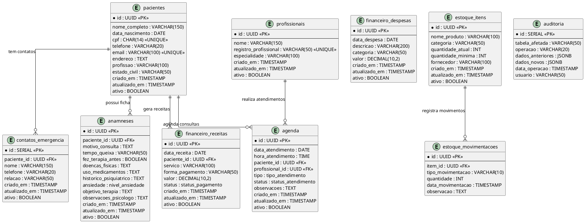

# 10 — Diagrama de Entidade e Relacionamento (DER)

## Descrição

O Diagrama de Entidade e Relacionamento (DER) do PsiClinic representa as 10 tabelas do banco de dados PostgreSQL e seus relacionamentos. O modelo segue os padrões da disciplina de POBD, com foco em integridade referencial via chaves estrangeiras e uso de UUID como identificadores.

**Notação utilizada:** PlantUML (Crow's Foot / IE notation via `||--o{`)

**Como visualizar:**
1. Acesse [https://www.plantuml.com/plantuml/uml/](https://www.plantuml.com/plantuml/uml/)
2. Cole o código abaixo na caixa de texto
3. Clique em "Submit"

Alternativamente, use a extensão **PlantUML** no VS Code com o servidor local ou online.

---

## Código PlantUML

---

## Legenda

| Notação | Significado |
|---|---|
| `||--o{` | Um para muitos (1:N) obrigatório no lado "um" |
| `<<PK>>` | Chave primária |
| `<<FK>>` | Chave estrangeira |
| `<<UNIQUE>>` | Restrição de unicidade |
| `UUID` | Identificador universal único (via `uuid_generate_v4()`) |
| `SERIAL` | Inteiro sequencial auto-incremento |
| `BOOLEAN` | Remoção lógica (`ativo`) |
| `JSONB` | JSON binário para snapshots de auditoria |

---

## Notas sobre o Modelo

- A tabela `auditoria` não possui chave estrangeira — ela é populada dinamicamente por triggers via `TG_TABLE_NAME`, capturando qualquer tabela monitorada.
- `financeiro_despesas` não tem FK para `pacientes` pois despesas são operacionais (aluguel, material, etc.) e não vinculadas a um paciente específico.
- `estoque_movimentacoes` não possui `ativo` por ser um log imutável — registros nunca são inativados.
- `agenda` possui dois relacionamentos com tabelas diferentes: um com `pacientes` (quem é atendido) e outro com `profissionais` (quem atende).
