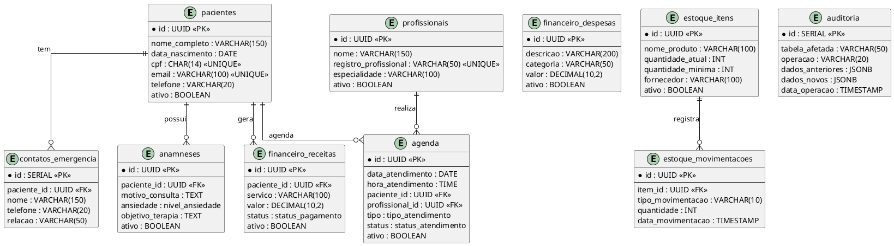

# PsiClinic — Documentação Final

---

**Projeto:** PsiClinic — Sistema de Gestão para Clínica de Psicologia
**Disciplina:** Programação e Otimização de Banco de Dados (POBD)
**Instituição:** UNIBRA — Centro Universitário Brasileiro
**Professor:** André Ribeiro
**Data de entrega:** 03/06/2026

---

## Sumário

1. [Introdução](#1-introdução)
2. [Objetivo do Projeto](#2-objetivo-do-projeto)
3. [Tecnologias Utilizadas](#3-tecnologias-utilizadas)
4. [Modelagem do Banco de Dados](#4-modelagem-do-banco-de-dados)
5. [Stored Procedures](#5-stored-procedures)
6. [Functions](#6-functions)
7. [Triggers](#7-triggers)
8. [Views](#8-views)
9. [Integração com a API](#9-integração-com-a-api)
10. [Diagrama de Entidade e Relacionamento (DER)](#10-diagrama-de-entidade-e-relacionamento-der)
11. [Conclusão](#11-conclusão)
12. [Checklist de Entrega](#12-checklist-de-entrega)

---

## 1. Introdução

O presente documento descreve o projeto **PsiClinic**, desenvolvido como trabalho final da disciplina de Programação e Otimização de Banco de Dados (POBD), ministrada pelo professor André Ribeiro na UNIBRA.

O PsiClinic é um sistema web de gestão clínica voltado para clínicas de psicologia, integrando um banco de dados PostgreSQL hospedado no Supabase a uma aplicação web moderna construída com Next.js 15 e TypeScript.

O projeto foi desenvolvido ao longo de seis módulos progressivos:

| Módulo | Descrição |
|---|---|
| Módulo 1 | Pacientes e Anamnese |
| Módulo 2 | Agenda de Atendimentos |
| Módulo 3 | Controle Financeiro |
| Módulo 4 | Controle de Estoque |
| Módulo 5 | Relatórios e Dashboards |
| Módulo 6 | Infraestrutura e Entrega Final |

---

## 2. Objetivo do Projeto

O objetivo principal é demonstrar a aplicação prática de recursos avançados de banco de dados relacional no contexto de um sistema real, com ênfase nos seguintes aspectos:

**Stored Procedures** — Encapsulamento das operações de escrita no banco, garantindo que regras de negócio (como o cadastro transacional de pacientes, o controle de estoque e o registro financeiro) sejam aplicadas de forma centralizada, independente da camada de aplicação.

**Functions** — Cálculos e validações reutilizáveis, como o cálculo de idade, o cálculo de lucro líquido por período e a verificação do status crítico de itens de estoque.

**Triggers** — Automação de comportamentos do banco sem intervenção da aplicação: auditoria completa de operações, atualização automática de timestamps e validação de conflitos de agenda.

**Views** — Abstração de queries complexas em objetos nomeados e reutilizáveis, fornecendo uma interface de leitura limpa e consistente para o frontend.

**Integração com aplicação web** — Demonstração de como uma API Next.js consome esses recursos de forma segura, sem expor a camada de dados ao cliente.

---

## 3. Tecnologias Utilizadas

| Camada | Tecnologia | Versão |
|---|---|---|
| Framework Web | Next.js (App Router) | 16.2.6 |
| Linguagem | TypeScript | 5.7.3 |
| Estilização | Tailwind CSS | 4.x |
| Componentes | Radix UI | Múltiplas |
| Gráficos | Recharts | 2.15.0 |
| Banco de Dados | PostgreSQL (Supabase) | — |
| Driver de Banco | pg (node-postgres) | 8.20.0 |
| Formulários | React Hook Form + Zod | — |
| Notificações | Sonner | 1.7.1 |
| Ícones | Lucide React | 0.564.0 |

---

## 4. Modelagem do Banco de Dados

### Visão Geral do Modelo

O banco de dados foi projetado com 10 tabelas, utilizando os seguintes padrões globais:

- **UUID como chave primária** (via `uuid_generate_v4()`) em todas as tabelas de domínio.
- **Remoção lógica** via campo `ativo BOOLEAN DEFAULT TRUE` — nenhum dado de negócio é deletado fisicamente.
- **Timestamps automáticos** via triggers `BEFORE UPDATE`.
- **Integridade referencial** com `ON DELETE RESTRICT` em todas as chaves estrangeiras.

### Tipos Enumerados

| Tipo | Valores |
|---|---|
| `status_atendimento` | `agendado`, `confirmado`, `realizado`, `cancelado`, `faltou` |
| `tipo_atendimento` | `presencial`, `online` |
| `status_pagamento` | `pago`, `pendente`, `cancelado` |
| `nivel_ansiedade` | `leve`, `moderada`, `intensa` |

### Tabelas

**`auditoria`** — Log centralizado e imutável de todas as operações nas tabelas monitoradas. Populada exclusivamente por triggers.

**`pacientes`** — Cadastro base dos pacientes. Entidade central do modelo, referenciada por agenda, anamneses, contatos de emergência e receitas.

**`contatos_emergencia`** — Contatos de segurança vinculados a pacientes (N:1 com pacientes).

**`anamneses`** — Ficha clínica detalhada, criada junto ao paciente e atualizada ao longo do acompanhamento terapêutico.

**`profissionais`** — Cadastro de psicólogos e profissionais de saúde da clínica.

**`agenda`** — Agendamentos de consulta com ciclo de vida controlado por ENUMs. Sujeita à trigger de validação de conflito.

**`financeiro_receitas`** — Entradas financeiras (sessões pagas). Considera apenas registros com `status = 'pago'` nos relatórios.

**`financeiro_despesas`** — Saídas operacionais da clínica (aluguel, materiais, etc.).

**`estoque_itens`** — Catálogo de materiais com saldo atual e quantidade mínima de alerta.

**`estoque_movimentacoes`** — Histórico imutável de entradas e saídas do almoxarifado.

---

## 5. Stored Procedures

O PsiClinic utiliza **14 stored procedures** escritas em PL/pgSQL. Todas as operações de escrita em tabelas de domínio passam obrigatoriamente por uma procedure. As procedures `sp_atualizar_anamnese_completa` e `sp_atualizar_paciente_completo` foram adicionadas via patches SQL incrementais (`docs/sql/`) após a validação final do projeto.

### Pacientes e Anamnese

**`sp_registrar_paciente_completo(p_nome, p_nascimento, p_cpf, p_tel, p_email, p_end, p_prof, p_civil, p_emerg_nome, p_emerg_tel, p_emerg_rel, p_motivo, p_queixa_tempo)`**

Cadastro transacional e atômico de paciente, contato de emergência e anamnese inicial. Qualquer falha reverte toda a operação. Utiliza `RETURNING id` para encadear os INSERTs dependentes.

```sql
CALL sp_registrar_paciente_completo(
  'Maria Silva', '1990-05-15', '123.456.789-00',
  '(81) 99999-0000', 'maria@email.com', NULL, NULL, NULL,
  'João Silva', '(81) 88888-0000', 'Pai',
  'Ansiedade generalizada', '6 meses'
);
```

**`sp_atualizar_anamnese(p_anamnese_id, p_obs_psicologo, p_objetivo, p_ansiedade)`**

Permite que o psicólogo registre observações clínicas, objetivo terapêutico e nível de ansiedade avaliado (3 campos). Mantida por compatibilidade.

**`sp_atualizar_anamnese_completa(p_anamnese_id, + 19 parâmetros clínicos)`**

Procedure completa de atualização da ficha de anamnese, cobrindo todos os 18 campos que a tela de Anamnese gerencia: motivo de consulta, histórico de terapia, doenças físicas, uso de medicamentos, histórico psiquiátrico, saúde mental familiar, hábitos de sono e alimentação, uso de substâncias, atividade física, avaliação de ansiedade, humor, estresse, pensamentos recorrentes, objetivo terapêutico e observações do psicólogo. Substitui o UPDATE direto que havia na rota `PUT /api/pacientes/anamnese`. Usa `COALESCE` para preservar o motivo de consulta se nulo.

```sql
CALL sp_atualizar_anamnese_completa(
  'uuid-anamnese',
  'Ansiedade generalizada', '6 meses', TRUE, '2 anos',
  NULL, NULL, NULL, NULL, NULL,
  'Dorme bem', 'Regular', NULL, 'Caminhada',
  'moderada', 'Estável', 'Médio', NULL,
  'Reduzir episódios de ansiedade',
  'Paciente demonstra progresso notável.'
);
```

**`sp_atualizar_paciente_completo(p_paciente_id, p_nome, p_nascimento, p_cpf, p_tel, p_email, p_end, p_prof, p_civil, p_emerg_nome, p_emerg_tel, p_emerg_rel)`**

Atualiza dados cadastrais de um paciente ativo e seu contato de emergência. Se o contato de emergência não existir, é criado. Encapsula a lógica transacional que anteriormente usava `BEGIN/COMMIT/ROLLBACK` na camada de aplicação.

```sql
CALL sp_atualizar_paciente_completo(
  'uuid-paciente',
  'Maria Silva Atualizado', '1990-05-15', '123.456.789-00',
  '(81) 99999-0001', 'maria.novo@email.com',
  'Rua B, 456', 'Engenheira', 'Casada',
  'João Silva', '(81) 88888-0001', 'Pai'
);
```

### Agenda

**`sp_agendar_atendimento(p_data, p_hora, p_paciente, p_profissional, p_tipo, p_obs)`**

Insere um novo agendamento. Dispara a trigger `trg_verificar_agenda` que valida conflito de horário no banco antes de persistir.

**`sp_atualizar_status_atendimento(p_agenda_id, p_status)`**

Procedure base chamada pelas quatro procedures de status a seguir.

**`sp_confirmar_atendimento` / `sp_cancelar_atendimento` / `sp_marcar_atendimento_realizado` / `sp_marcar_falta_atendimento`**

Wrappers semânticos que chamam `sp_atualizar_status_atendimento` com o status correspondente. A API mapeia ações textuais (`confirmar`, `cancelar`, `realizar`, `falta`) para a procedure correta.

### Financeiro

**`sp_registrar_receita(p_paciente, p_servico, p_forma, p_valor)`**

Registra uma entrada financeira. Status padrão é `'pago'`. Para outros status, a API realiza uma segunda chamada a `sp_atualizar_status_pagamento` após obter o ID da nova receita.

**`sp_registrar_despesa(p_desc, p_cat, p_valor)`**

Registra uma despesa operacional.

**`sp_atualizar_status_pagamento(p_receita_id, p_status)`**

Altera o status de pagamento. Requer cast explícito `$2::status_pagamento` pelo driver pg.

### Estoque

**`sp_movimentar_estoque(p_item_id, p_tipo, p_qtd, p_obs)`**

Valida tipo (`entrada`/`saida`), verifica existência do item, valida saldo para saídas, registra histórico em `estoque_movimentacoes` e atualiza `quantidade_atual` em `estoque_itens`. Lança exceções descritivas para cada tipo de falha, mapeadas pela API em HTTP 400 ou 409.

---

## 6. Functions

O PsiClinic utiliza **6 functions** PL/pgSQL:

### Functions de Negócio

**`fn_calcular_idade(p_data_nascimento DATE) → INT`**

Calcula a idade atual em anos completos usando `EXTRACT(YEAR FROM age(...))`. Utilizada na view `vw_pacientes_ativos` para evitar armazenar um campo que muda com o tempo.

**`fn_calcular_lucro_liquido(p_data_inicio DATE, p_data_fim DATE) → DECIMAL(10,2)`**

Retorna `SUM(receitas pagas) - SUM(despesas)` no período informado. Usa `COALESCE(..., 0)` para retornar zero quando não há movimentação no período. Consumida por `GET /api/financeiro/lucro` e `GET /api/relatorios/resumo`.

**`fn_verificar_status_estoque(p_item_id UUID) → VARCHAR(20)`**

Compara `quantidade_atual` com `quantidade_minima` e retorna `'CRÍTICO'`, `'NORMAL'` ou `'INEXISTENTE'`. Usada na listagem de estoque e nos relatórios para colorir badges de status na interface.

### Functions de Trigger

**`fn_atualizar_timestamp() → TRIGGER`**

Callback para triggers `BEFORE UPDATE`. Atribui `NEW.atualizado_em = CURRENT_TIMESTAMP` antes de persistir, garantindo rastreabilidade sem código adicional na API.

**`fn_auditoria_geral() → TRIGGER`**

Callback para triggers `AFTER INSERT/UPDATE/DELETE`. Registra snapshots `to_jsonb(OLD)` e `to_jsonb(NEW)` na tabela `auditoria`, criando uma trilha imutável de todas as alterações nas tabelas monitoradas.

**`fn_validar_conflito_agenda() → TRIGGER`**

Callback para trigger `BEFORE INSERT OR UPDATE` na tabela `agenda`. Usa `EXISTS(SELECT 1 FROM agenda WHERE profissional_id = NEW.profissional_id AND data = NEW.data AND hora = NEW.hora AND id != NEW.id AND ativo = TRUE AND status != 'cancelado')`. Se conflito encontrado, lança `RAISE EXCEPTION` abortando a transação.

---

## 7. Triggers

O schema implementa **três grupos de triggers**, totalizando mais de 16 triggers ativos:

### Grupo 1 — Auditoria (AFTER INSERT OR UPDATE OR DELETE)

| Trigger | Tabela |
|---|---|
| `trg_audit_pacientes` | `pacientes` |
| `trg_audit_agenda` | `agenda` |
| `trg_audit_receitas` | `financeiro_receitas` |
| `trg_audit_despesas` | `financeiro_despesas` |

Todos executam `fn_auditoria_geral()` **após** a operação, gravando snapshots JSON na tabela `auditoria`. O uso de `AFTER` garante que o log só existe se a operação principal foi bem-sucedida.

### Grupo 2 — Timestamps (BEFORE UPDATE)

Criados dinamicamente via bloco `DO $$` para as tabelas: `pacientes`, `contatos_emergencia`, `anamneses`, `profissionais`, `agenda`, `financeiro_receitas`, `financeiro_despesas`, `estoque_itens`.

Nome padrão: `trg_upd_timestamp_{tabela}`. Executam `fn_atualizar_timestamp()` **antes** de persistir o UPDATE, modificando `NEW.atualizado_em`.

### Grupo 3 — Validação de Negócio (BEFORE INSERT OR UPDATE)

**`trg_verificar_agenda`** — Executa `fn_validar_conflito_agenda()` **antes** de qualquer INSERT ou UPDATE na tabela `agenda`. Garante que o banco rejeite conflitos de horário independentemente de como o dado chegou (API, SQL direto, migração).

---

## 8. Views

| View | Tabelas Envolvidas | Uso Principal |
|---|---|---|
| `vw_pacientes_ativos` | `pacientes` | Listagem de pacientes, estatísticas |
| `vw_agenda_diaria` | `agenda`, `pacientes`, `profissionais` | Agenda do dia, card de resumo |
| `vw_resumo_financeiro_mensal` | `financeiro_receitas`, `financeiro_despesas` | Gráficos financeiros, card de lucro |
| `vw_lista_estoque_critico` | `estoque_itens` | Alertas de estoque baixo, relatórios |

**`vw_pacientes_ativos`** — Lista pacientes com `ativo = TRUE` e a idade calculada em tempo real por `fn_calcular_idade`.

**`vw_agenda_diaria`** — JOIN entre agenda, pacientes e profissionais, filtrado por `data_atendimento = CURRENT_DATE`. Desnormaliza os nomes para exibição direta na interface.

**`vw_resumo_financeiro_mensal`** — CTE com FULL OUTER JOIN entre receitas (agrupadas por mês) e despesas (agrupadas por mês), calculando `lucro_liquido = total_receitas - total_despesas`. Considera apenas receitas com `status = 'pago'`.

**`vw_lista_estoque_critico`** — Filtra itens com `quantidade_atual < quantidade_minima AND ativo = TRUE`, retornando apenas os dados necessários para o alerta (nome, saldo, mínimo, fornecedor).

---

## 9. Integração com a API

A camada de API foi implementada como Route Handlers do Next.js 15 (App Router), em `src/app/api/`. São **20 endpoints** no total, organizados por módulo.

### Regras de segurança aplicadas em todos os endpoints

- `pool` (conexão com banco) importado exclusivamente em arquivos server-side.
- Queries 100% parametrizadas (`$1`, `$2`, ...) — sem concatenação de strings com dados do usuário.
- Operações de escrita em tabelas de domínio delegadas obrigatoriamente a stored procedures.
- `DATABASE_URL` nunca exposta em logs ou respostas.

### Rotas por módulo

**Pacientes:** `GET/POST/PUT/DELETE /api/pacientes`, `PUT /api/pacientes/anamnese`

- `PUT /api/pacientes` → chama `sp_atualizar_paciente_completo`
- `PUT /api/pacientes/anamnese` → chama `sp_atualizar_anamnese_completa` (20 parâmetros, 18 campos clínicos)

**Profissionais:** `GET /api/profissionais`

**Agenda:** `GET/POST /api/agenda`, `GET /api/agenda/diaria`, `PATCH /api/agenda/status`

**Financeiro:** `GET/POST/DELETE /api/financeiro/receita`, `PATCH /api/financeiro/receita/status`, `GET/POST/DELETE /api/financeiro/despesa`, `GET /api/financeiro/resumo`, `GET /api/financeiro/lucro`

**Estoque:** `GET/POST/PATCH/DELETE /api/estoque`, `GET /api/estoque/critico`, `POST /api/estoque/movimentar`

**Relatórios:** `GET /api/relatorios/resumo`, `GET /api/relatorios/financeiro`, `GET /api/relatorios/pacientes`, `GET /api/relatorios/agenda`, `GET /api/relatorios/estoque`

**Usuários:** `GET/POST/PUT/DELETE /api/usuarios` — tabela `usuarios` criada via patch incremental

**Diagnóstico:** `GET /api/test-db`

---

## 10. Diagrama de Entidade e Relacionamento (DER)

O DER abaixo está em formato PlantUML. Para visualizar, acesse [https://www.plantuml.com/plantuml/uml/](https://www.plantuml.com/plantuml/uml/) e cole o código.



---

## 11. Conclusão

O desenvolvimento do projeto PsiClinic proporcionou uma experiência completa de como um banco de dados relacional moderno pode ser muito mais do que um simples repositório de dados — ele pode ser a camada mais inteligente e segura de um sistema de software.

Ao longo do projeto, ficou evidente que o uso de **Stored Procedures** para encapsular operações de escrita traz benefícios concretos: qualquer regra de negócio definida na procedure é aplicada independentemente de como o dado chega ao banco — seja pela API, por uma ferramenta de administração ou por outro sistema. No caso da `sp_registrar_paciente_completo`, por exemplo, a criação transacional garantiu que jamais existisse um paciente sem contato de emergência ou sem anamnese inicial no banco.

As **Functions** demonstraram sua utilidade ao eliminar duplicação de lógica. O cálculo de idade em `fn_calcular_idade`, por exemplo, poderia ter sido implementado na aplicação JavaScript, mas ao colocá-lo no banco via view `vw_pacientes_ativos`, garantimos que qualquer consulta — da API, de relatórios ou de queries diretas — sempre retorne o mesmo resultado correto e atualizado.

Os **Triggers** foram um dos aspectos mais impactantes do projeto. A auditoria centralizada via `fn_auditoria_geral` mostrou como é possível implementar rastreabilidade completa sem adicionar código às operações de negócio. Toda alteração em pacientes, agenda e finanças é automaticamente registrada com snapshot JSON antes e depois — uma funcionalidade que seria complexa e frágil se implementada na camada de aplicação. Da mesma forma, a trigger de validação de conflito de agenda demonstrou que regras de integridade crítica pertencem ao banco, não à aplicação.

A integração com o **Supabase** mostrou como um banco PostgreSQL pode ser disponibilizado na nuvem de forma simples, com suporte a SSL e autenticação, mantendo toda a expressividade e poder do PostgreSQL. O projeto simulou de forma realista um sistema clínico em produção, com separação clara entre camada de dados, camada de API server-side e camada de apresentação client-side.

Em suma, o PsiClinic consolidou a compreensão de que a disciplina de banco de dados vai muito além do SELECT básico: envolve modelagem cuidadosa, otimização de consultas via views, segurança e auditoria via triggers, e encapsulamento de regras via procedures e functions — recursos que fazem a diferença entre um banco de dados simples e um banco de dados profissional.

---

## 12. Checklist de Entrega

### Banco de Dados
- [x] Schema aplicado no Supabase
- [x] 10 tabelas criadas com constraints e relacionamentos
- [x] 12 Stored Procedures implementadas
- [x] 6 Functions implementadas
- [x] 16+ Triggers implementados
- [x] 4 Views implementadas

### Backend / API
- [x] 25 rotas de API implementadas
- [x] Conexão com banco validada via `/api/test-db`
- [x] Queries parametrizadas em 100% das rotas
- [x] Stored procedures chamadas para todas as escritas de domínio
- [x] `PUT /api/pacientes` chama `sp_atualizar_paciente_completo`
- [x] `PUT /api/pacientes/anamnese` chama `sp_atualizar_anamnese_completa`
- [x] `GET/POST/PUT/DELETE /api/usuarios` implementados

### Frontend
- [x] 6 módulos integrados com dados reais (incluindo Usuários)
- [x] Dados mockados removidos (incluindo `mockUsers`)
- [x] `pool` não exposto no cliente

### Qualidade
- [x] `npm run build` executado com sucesso (25 rotas, zero erros TypeScript)
- [x] `npx tsc --noEmit` sem erros
- [x] `.env.local` fora do Git

### Documentação
- [x] 10 documentos técnicos criados na pasta `docs/`
- [x] Pasta `docs/sql/` com 3 patches SQL incrementais
- [x] DER em PlantUML gerado
- [x] `DOCUMENTACAO_FINAL.md` consolidado e atualizado
- [x] `README.md` atualizado (versão corrigida para Next.js 16.2.6)

### Entrega
- [ ] Patches SQL aplicados no Supabase SQL Editor
- [ ] PDF gerado a partir deste documento
- [ ] Submissão no Google Classroom até 03/06/2026
